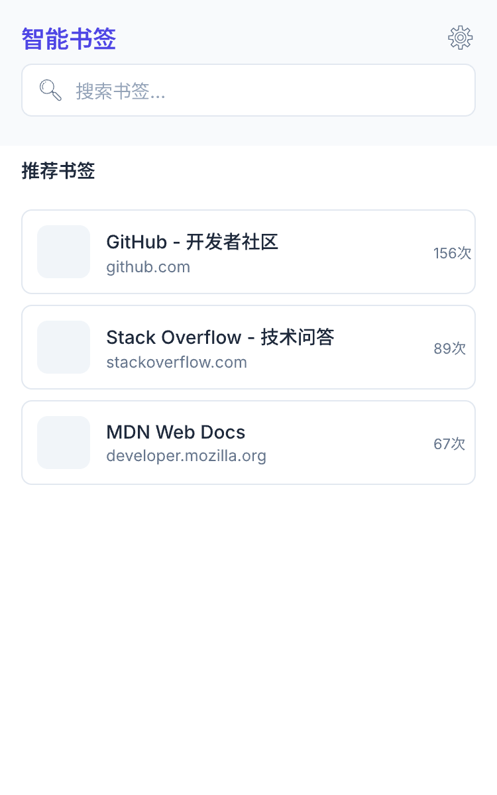
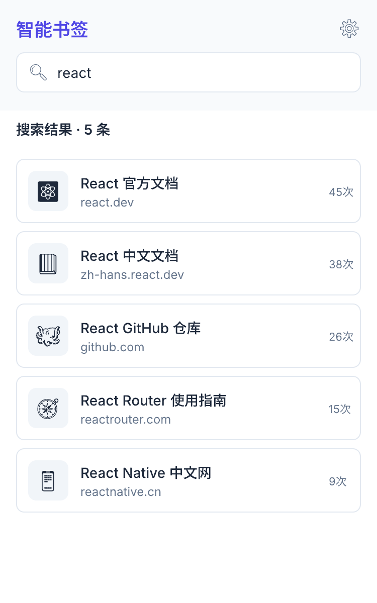

<div align="center">


# 智能书签 Smart Bookmark Manager

**模糊搜索 · 访问频次排序 · 自动快照 —— 让书签栏越用越懂你**

一款基于 Chrome Manifest V3 的书签管理扩展：输入即搜、常用置顶、每日备份，
书签多到翻不动的时候，它替你记住一切。

[](https://developer.chrome.com/docs/extensions/develop/migrate) [](https://github.com/Real102/intelligent-mark/releases) [](https://www.typescriptlang.org/) [](https://vitest.dev/)

<p>
  
  
  
</p>


*左：推荐书签（按访问频次） · 右：模糊搜索结果（含完整路径）*

</div>

---

## 它解决什么问题

| 痛点 | 智能书签的解法 |
|:---|:---|
| 书签太多，翻半天找不到 | 输入即搜，title / URL 模糊匹配 + 子序列兜底 |
| 常用网站埋在文件夹深处 | 按访问频次自动排序，越常用越靠前 |
| 手滑误删、整理时弄乱顺序 | 每日自动快照，一键恢复到任意一天 |
| 同一页面收藏了好几遍 | 三层去重算法，揪出 URL 重复与疑似重复 |
| 担心数据被上传 | 所有数据仅存于 `chrome.storage.local`，零网络请求 |

## 功能一览

| 功能 | 说明 |
|:---|:---|
| **模糊搜索** | 搜索词小写化后匹配 title / URL，支持字符子序列命中；按相关性得分降序，同分按访问次数降序；结果含 favicon、标题、完整书签路径，悬停可复制链接，点击新标签页打开 |
| **推荐书签** | 弹窗常驻展示访问频次最高的 3 条书签，一键直达；无访问记录时展示空状态 |
| **频次排序** | 文件夹内书签按访问次数降序自动排列；未访问的保持原顺序；文件夹、根级书签、"其他书签"完全不动 |
| **重复检测** | 设置页手动触发，三层算法定位 URL 重复与疑似重复，展示每条书签的完整路径，由你自行决定去留 |
| **自动快照** | 每次打开浏览器自动创建快照（每天最多 1 份），gzip 压缩存储，保留最近 7 份，恢复前二次确认 |
| **存储预警** | 实时监测 `chrome.storage.local` 使用率，超过 80% 警告、超过 95% 报错，横幅展示在设置页顶部 |

### 搜索打分规则

| 优先级 | 匹配方式 | 得分 |
|:---:|:---|:---:|
| 1 | 搜索词与 title 完全相等 | 1.0 |
| 2 | title 包含搜索词 | 0.5 |
| 3 | 搜索词按字符子序列出现在 title 中 | 0.4 |
| 4 | URL 包含搜索词 | 0.3 |

### 访问计数规则

只统计**真实有效**的访问行为：

- 监听 `chrome.webNavigation.onCommitted`（主帧加载）
- 仅记录 `link` / `typed` / `auto_bookmark` 三种跳转方式，刷新、前进后退不计
- 仅处理 `http://` / `https://` 协议
- **域名 + 路径精确匹配**：访问 `github.com/user/repo` 只给完全一致的书签 +1，`github.com/user/repo-new` 与 `github.com` 均不计入

### 去重三层算法

```
第一层  URL 标准化 hash 分组     → 命中即 "URL 重复"
第二层  域名 + 一级路径前缀分组  → 同组进入第三层
第三层  组内 title 子串相似判断  → 命中即 "疑似重复"
```

<details>
<summary><b>设计原则："其他书签"完全静默</b></summary>

Chrome 自带的"其他书签"文件夹内的任何内容——不搜索、不推荐、不排序、不计数、不检测重复。
你的同步书签、旧书签堆放区保持原样，插件绝不打扰。

</details>

## 安装

### 方式一：下载 Release（推荐）

1. 前往 [Releases](https://github.com/Real102/intelligent-mark/releases) 页面，下载最新版 `intelligent-mark-vX.Y.Z.zip`
2. 解压 zip 到任意固定目录（加载后不要删除该目录）
3. 打开 Chrome，访问 `chrome://extensions/`
4. 开启右上角 **开发者模式**
5. 点击 **加载已解压的扩展程序**，选择解压出的目录

### 方式二：从源码构建

```bash
git clone https://github.com/Real102/intelligent-mark.git
cd intelligent-mark
npm install
npm run build
```

构建产物在 `dist/` 目录，按上面方式一的步骤 3-5 加载 `dist/` 即可。

> 要求：Node.js 18+，Chrome 100+

## 项目结构

```
intelligent-mark/
├── src/
│   ├── background/          # Service Worker
│   │   └── handlers/         #   visitCount 访问计数 · sort 自动排序 · snapshot 每日快照
│   ├── popup/                # 弹窗主界面（搜索 + 推荐）
│   ├── options/              # 设置页（快照管理 / 重复检测 / 存储预警）
│   ├── components/           # 通用 React 组件
│   ├── lib/                  # 纯函数核心逻辑，与 *.test.ts 同目录
│   │   ├── searcher.ts       #   模糊搜索 + 推荐列表
│   │   ├── sorter.ts         #   频次排序
│   │   ├── dedupe.ts         #   三层去重
│   │   ├── snapshot.ts       #   快照创建 / 恢复 / 滚动清理
│   │   └── filter.ts         #   "其他书签"静默过滤
│   ├── styles/               # Tailwind 基础样式
│   └── types/                # 共享类型定义
├── release.ps1               # 一键发布 GitHub Release
└── manifest.json             # Manifest V3 清单
```

## 技术栈

| 层 | 技术 |
|:---|:---|
| UI | React 18 · TailwindCSS 3 · lucide-react |
| 状态 | Zustand |
| 构建 | Vite 5 · @crxjs/vite-plugin |
| 语言 | TypeScript 5.5（strict 模式，零 ESLint 依赖，靠编译器保证质量） |
| 压缩 | pako（gzip + base64 快照） |
| 测试 | Vitest（核心逻辑单元测试覆盖：搜索 / 排序 / 去重 / 快照 / 过滤） |

## 开发

```bash
npm run dev          # 启动 Vite 开发服务器（HMR）
npm run build        # 类型检查 + 生产构建
npm run typecheck    # 仅 TypeScript 类型检查
npm test             # 运行全部单元测试
npm run test:watch   # 测试监听模式
```

运行单个测试文件：

```bash
npx vitest run src/lib/searcher.test.ts
```

### 发布新版本

```powershell
.\release.ps1                 # patch 版本 +1：构建 → 打包 → 推 tag → 创建 Release
.\release.ps1 -Bump minor    # minor 版本 +1（major 同理）
.\release.ps1 -SkipBuild     # dist 已是最新时跳过构建
```

## 隐私

所有书签数据、访问记录、快照**仅存储在本地 `chrome.storage.local`**，不上传任何服务器，无任何网络请求。

| 权限 | 用途 |
|:---|:---|
| `bookmarks` | 读取 / 排序 / 恢复书签 |
| `storage` | 本地存储访问计数、快照、设置 |
| `webNavigation` | 监听页面加载以统计真实访问 |
| `http://*/*` `https://*/*` | webNavigation 事件过滤所需 |

## Roadmap

- [ ] 快照预览对比 —— 恢复前展示差异，确认后再执行
- [ ] meta description 参与搜索权重
- [ ] 基于历史数据的智能推荐增强
- [ ] 标签（Tag）功能

---

<div align="center">

**如果这个插件帮到了你，欢迎点一个 Star**

[报告问题](https://github.com/Real102/intelligent-mark/issues) · [查看版本历史](https://github.com/Real102/intelligent-mark/releases)

</div>
